# 🏟️ SportsAgentic Infrastructure (OCI & OpenTofu)

Production-grade Infrastructure-as-Code (IaC) repository for **SportsAgentic**, managing cloud infrastructure on Oracle Cloud Infrastructure (OCI) using **OpenTofu**.

---

## 🏛️ Architecture Overview



Production cloud platform engineered on Oracle Cloud Infrastructure (OCI) using OpenTofu:
- **DNS & Traffic Entry**: Porkbun domain registration delegated to OCI Public Anycast DNS Zone (`sportsagentic.dev`) with Apex and Wildcard A records resolving to an OCI Flexible Load Balancer (10 Mbps Always Free shape, reserved public IP).
- **Virtual Cloud Network (10.0.0.0/16)**: Segregated subnets for Public Load Balancers (`10.0.1.0/24`), Kubernetes API (`10.0.0.0/28`), and Private Worker Nodes (`10.0.10.0/24`), interconnected via Internet Gateway, NAT Gateway, and Service Gateway (OSN).
- **Compute & OKE Kubernetes (v1.34+)**: Consolidated single untainted worker node pool (`model-pool`) on ARM Ampere A1 (`VM.Standard.A1.Flex`, 4 OCPUs, 24 GB RAM) or E5 x86 shape, co-locating platform controllers and AI workloads without scheduling taints.
- **Platform & Security Namespaces**:
  - `ingress-nginx`: Ingress-Nginx controller (v4.11.3) managing routing for `sportsagentic.dev` (SPA root `/`) and API traffic (`/api/*` rewriting with proxy buffering disabled). The OCI load balancer passes client IPs to nginx with PROXY protocol v2, so `X-Real-IP` carries the real client address.
  - `cert-manager`: Cert-Manager (v1.16.1) with Let's Encrypt ACME ClusterIssuer automating SSL/TLS certificate renewal (`sportsagentic-tls`).
  - `sportsagentic`: Application workloads including `sportsagentic-web` (React SPA on Nginx), `sportsagentic-agent` (FastAPI orchestrator), `sportsagentic` (Go MCP server), and `llama-server` / `sportsagentic-inference` (FastAPI gateway + llama.cpp runtime with PVC model weight caching).
- **OCI Managed Services**: OCI NoSQL database (`sportsagentic_cfb` table with millisecond timestamps), private OCIR container repositories (`sportsagentic/mcp-server`, `sportsagentic/agent-model`, `sportsagentic/web`), and S3-compatible remote state on OCI Object Storage with native state locking.

---

## 📦 Directory Structure

```text
SportsAgenticInfra/
├── .github/
│   └── workflows/
│       ├── ci-pr.yml              # PR validation (fmt, validate, Trivy IaC security, plan comment)
│       ├── cd-apply.yml           # Gated apply on merge to main via production approval environment
│       └── drift-check.yml        # Nightly scheduled drift detection and GitHub issue alerting
├── bootstrap/                     # I-0: Foundation stack (state bucket, CI user, IAM policies)
│   ├── main.tf
│   ├── variables.tf
│   ├── outputs.tf
│   └── terraform.tfvars.example
├── modules/
│   ├── network/                   # I-1: VCN, subnets, IGW, NAT GW, Service GW, Route Tables, Security Lists
│   ├── iam/                       # I-1: OKE worker node dynamic groups, cluster join policies
│   ├── oke/                       # I-2: OKE cluster, services node pool, tainted model pool @ size 0
│   └── platform/                  # I-3: OCIR repos, NoSQL table + IAM read policy, DNS zone, Ingress, cert-manager
├── docs/
│   ├── authentication.md          # CI/CD authentication architecture & OIDC limitation analysis
│   ├── bootstrap.md               # Step-by-step bootstrap execution guide
│   ├── dns-setup.md               # Porkbun to OCI DNS delegation guide
│   └── testing.md                 # Complete guide for tofu test, Checkov, and Terratest
├── tests/                         # Native OpenTofu unit test suite (mock_provider)
│   ├── network.tftest.hcl
│   ├── oke.tftest.hcl
│   └── platform.tftest.hcl
├── test/                          # Terratest suite in Go
│   ├── go.mod
│   ├── go.sum
│   ├── network_test.go
│   ├── oke_test.go
│   ├── platform_test.go
│   └── test_helpers.go
├── .checkov.yaml                  # Checkov security scanner policy configuration
├── main.tf                        # Root orchestration
├── backend.tf                     # S3-compatible remote state on OCI Object Storage
├── providers.tf                   # oracle/oci, kubernetes, helm providers
├── variables.tf                   # Root configuration variables
├── outputs.tf                     # I-4: Exported values for application pipelines
├── terraform.tfvars.example
├── .tflint.hcl
└── .gitignore
```

---

## 🚀 Getting Started

### 1. Run the Bootstrap Stack (One-Time Setup)
Follow [`docs/bootstrap.md`](./docs/bootstrap.md) to initialize the OCI compartment, state storage bucket, and CI/CD credentials:

```bash
cd bootstrap
cp terraform.tfvars.example terraform.tfvars
# Fill in tenancy_ocid and region
tofu init
tofu apply
eval "$(tofu output -raw github_secrets_export_script)"
```

### 2. CI/CD Automation
* **Pull Requests**: Every PR against `main` automatically runs formatting checks, configuration validation, Trivy security scanning, and posts an interactive plan diff comment.
* **Landing Changes**: Merging into `main` generates a plan and pauses at the `production` GitHub Environment. Repository owners (`tmonteith`) approve the apply directly in GitHub.
* **Drift Detection**: Runs daily at 06:00 UTC and alerts via GitHub Issues if manual changes occur in OCI.

### 3. Domain Delegation
Follow [`docs/dns-setup.md`](./docs/dns-setup.md) to point `sportsagentic.dev` from Porkbun to your OCI Anycast nameservers.

